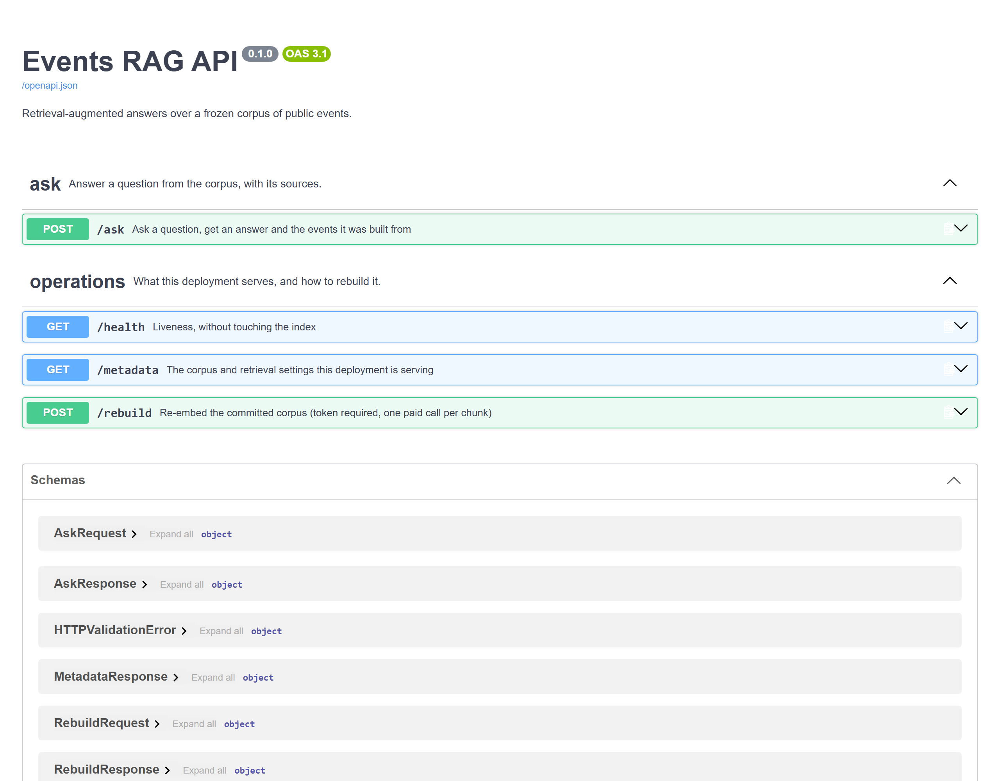
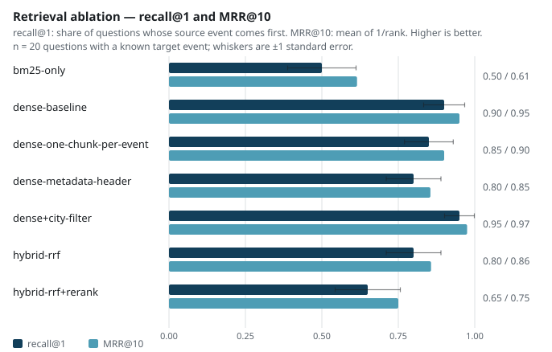

<h1 align="center">Events RAG</h1>

<p align="center">A question-answering API over a thousand public events, prompted to answer from them alone.</p>

<p align="center">
  
  
  
  
</p>

<div align="justify">

**Project status** — finished. The corpus is frozen in the repository. The retrieval table on this
page comes from the run of 2026-09-15. Its six rows that do not involve the reranker gave the same
recall and MRR values as the earlier run of 2026-09-03, and the reranking row changed after a
correction described below. The generation figures come from an archived run, kept in
`reports/evaluation_2026-09-02.json` and `reports/ragas_2026-09-02.json`. They have not been
measured since, because the model account behind them has no chat quota left, and each page that
quotes them names that archive. The thousand events and the thirty evaluation cases are committed,
so anyone with a Mistral API key can run the retrieval measurements again. The CI workflow runs
Ruff, Bandit and pytest. It is started by hand only, and its last run, on 2026-10-10, passed.

## The problem

Public event listings are published as faceted datasets, which a reader filters by city, by date
or by category. People ask questions such as *"is there something for a three-year-old near Alès
during the holidays, and is it free?"*, which combine four facets (audience, place, dates and
price) in ordinary words.

Retrieval-augmented generation (RAG) fits this kind of question. The system retrieves the events
closest to the question and has a language model answer from them. Evaluations of RAG systems
often ask a second language model to grade the answers. Each grade then costs a model call, and
the grades can change from one run to the next. Comparing two configurations of the pipeline
needs a benchmark that records the expected event for each question.

This repository asks two questions. Can the service answer a question of that kind, and what
evidence would distinguish one retrieval configuration from another?

The corpus is a frozen extract of 1 000 events from
[OpenAgenda's public events](https://public.opendatasoft.com/explore/dataset/evenements-publics-openagenda/),
restricted to the Occitanie region.

## What it does

```console
$ curl -X POST localhost:8000/ask -H 'Content-Type: application/json' \
    -d '{"question":"Un atelier pour apprendre à réparer son vélo à Toulouse au printemps ?","top_k":3}'
```

```json
{
  "answer": "Voici un événement correspondant à votre demande :\n\n**Atelier d'initiation à la mécanique vélo**\n- **Ville** : Toulouse\n- **Date** : 19 mai 2026 à 13h00\n- **Lieu** : DSNA-DTI, 1 avenue du docteur Maurice Grynfogel\n\n*Remarque* : Aucun autre atelier de réparation vélo n'est mentionné pour Toulouse dans le contexte fourni.",
  "sources": [
    { "uid": "58859316", "title": "Atelier d'auto-réparation vélo", "city": "Perpignan",  "date": "2026-05-01T16:00:00+02:00" },
    { "uid": "4721721",  "title": "Atelier d'initiation à la mécanique", "city": "Toulouse", "date": "2026-05-19T13:00:00+02:00" },
    { "uid": "73449814", "title": "Atelier réparation vélos", "city": "Narbonne", "date": "2026-05-20T14:00:00+02:00" }
  ]
}
```

This is a real response, shortened by removing the `score` field of each source, which the service
always sets to null. Retrieval returned three bike-repair workshops in three towns of the region.
The model chose the Toulouse one and added that the context mentioned no other workshop in
Toulouse.

The prompt tells the model to answer only from the retrieved events and to say so when they do not
hold the answer. The evaluation set includes five questions about events outside the corpus to
test this. In the archived run, asked about operas at the Opéra Bastille in Paris or about rock
concerts in Lyon, the model replied that the context held none.

<!-- source: docs/images/MANIFEST.json -->


`/rebuild` requires a token, because rebuilding the index calls a paid API and an anonymous
caller should not be able to start that.

### How it is built

A question reaches a **FastAPI** route served by **Uvicorn**. **Pydantic** models validate the
request and the response, and FastAPI builds the OpenAPI page above from the same models. The
service embeds the question with `mistral-embed` and searches a **FAISS** index built from the
committed corpus. The best chunks, five by default, go with the question to `mistral-small-latest`
through the Mistral client of **LangChain**, with a prompt that restricts the model to that
context. The indexer cuts the text of each event into chunks of at most 800 characters, and
`rank_bm25` provides the lexical search that the ablation compares with the dense index.

The main design choice is to keep the **FAISS** index in files on disk. The thousand events give
2 046 chunks, so the index holds 2 046 vectors. A managed vector database would add a service to
run and pay for, and a schema to migrate, for a capacity this corpus does not need.
`scripts/build_index.py` writes the index under `var/` in about a minute.

Retrieval is graded against the identifier of the event each question was written from, so no
model takes part in that grading. Generated answers have no such label, and **RAGAS** grades them
with a judge model. One of its five metrics returned null on every answer of the archived run and
is reported as not measured.

**pytest** runs the tests in three tiers and measures coverage on every run. The CI workflow also
runs **Ruff** and **Bandit**, and **uv** installs the environment from its lock file. **Docker**
packages the API and the corpus in one image, started by `docker compose up`, which mounts the
index from the local `var/` directory.

## The result

The ablation scores retrieval with `recall@k` and `MRR` on the twenty positive questions. Each of
them carries the `uid` of its source event, an exact relevance label, so no judge takes part. All
seven configurations below answer the same questions over the same corpus.

<!-- source: reports/ablation_results.json -->


> **How to read it.** Each configuration has two bars. recall@1 is the share of the twenty
> questions whose first result is the right event. MRR@10, the mean reciprocal rank over the first
> ten results, is the average of one over the rank where the right event appears. Longer bars are
> better. The whisker on the recall@1 bar is one standard error of a proportion at n = 20, and it
> is wide. Where two whiskers overlap, the chart cannot separate the two configurations, and the
> paired test further down compares them question by question.

<!-- source: reports/ablation_results.json -->
| Configuration | Chunking | recall@1 | recall@5 | MRR@10 | Median latency |
|---|---|---|---|---|---|
| `bm25-only` | baseline | 0.50 | 0.75 | 0.615 | 3.8 ms |
| `dense-baseline` | baseline | 0.90 | 1.00 | 0.950 | 192.7 ms |
| `dense-one-chunk-per-event` | one chunk per event | 0.85 | 0.95 | 0.900 | 165.6 ms |
| `dense-metadata-header` | metadata in text | 0.80 | 0.95 | 0.855 | 166.3 ms |
| `dense+city-filter` | baseline | 0.95 | 1.00 | 0.975 | 172.4 ms |
| `hybrid-rrf` | baseline | 0.80 | 0.95 | 0.857 | 210.2 ms |
| `hybrid-rrf+rerank` | baseline | 0.65 | 0.85 | 0.750 | 262.2 ms |
> n = 20 questions for every row, run of 2026-09-15.

> **How to read it.** One row per configuration, all answering the same twenty questions over the
> same corpus. recall@1 is the share of questions whose first result is the right event, and
> recall@5 the share where it appears among the first five distinct events. The service gives the
> model its five best chunks by default, and these belong to at most those five events, so an
> event missing from the top five of the shipped row cannot reach the answer. MRR@10 measures how
> high the right event sits. Median latency covers the retrieval step, including the call that
> embeds the question in the dense rows, and compares rows of this run on one machine.

Every number in the table is read from `reports/ablation_results.json`, which
`scripts/run_ablation.py` writes, and `tests/unit/test_published_numbers.py` fails if the table
and the file disagree. [`metrics.yaml`](metrics.yaml) defines each metric and what it means for
someone using the service. The latency column was measured on one machine during the same run,
so it is valid for comparing the rows with each other on that machine.

**The reranking row carried a wrong number for about two weeks.** The run of 2026-09-03 gave it
0.55 at recall@1, and that score measured a defect in the input of the reranker. The cross-encoder
received one passage per event, taken from a dictionary keyed by `uid` over the 2 046 chunks. For
each of the 487 events that the splitter had cut, about half of the corpus, the dictionary kept
only the last chunk, which holds the start date and lacks the title line. `passages_by_uid` now
joins the chunks of each event before scoring, and a unit test checks that an event cut in two
reaches the scorer with its title. Measured again on the joined passages, the row reads 0.65 at
recall@1, below the 0.80 of the hybrid search it reorders. The row was withdrawn on 2026-09-15 and
measured again the same day, and [`reports/errata.json`](reports/errata.json) records both steps.

<!-- source: reports/paired_comparison.json -->
Because the seven configurations answer the same twenty questions, any pair of them can be
compared on each question. The questions that one configuration gets right and the other gets
wrong carry the difference, and an average per configuration loses that information.
`scripts/compare_paired.py` reads the rank of the target event for each question and runs
McNemar's exact test against the shipped configuration, over n = 20 questions:

<!-- source: reports/paired_comparison.json -->
| Against `dense-baseline`, recall@1 | Questions won | Questions lost | McNemar p |
|---|---|---|---|
| `bm25-only` | 0 | 8 | 0.008 |
| `hybrid-rrf+rerank` | 1 | 6 | 0.125 |
| `dense-metadata-header` | 0 | 2 | 0.5 |
| `hybrid-rrf` | 0 | 2 | 0.5 |
| `dense-one-chunk-per-event` | 1 | 2 | 1.0 |
| `dense+city-filter` | 1 | 0 | 1.0 |
> n = 20 questions, the same twenty on both sides of every comparison.

The test was run twelve times, on the six configurations above at recall@1 and again at
recall@5. One comparison is significant at the 5 % level: at recall@1, BM25 alone loses eight
questions to dense retrieval and wins none. None of the other eleven, the city filter included,
reaches significance on twenty questions. The interval of a single proportion, about ±13 points
here, leads to the same reading with less power.

Dense retrieval puts the source event in the first five results for all twenty questions, and BM25
alone does so for fifteen. Among the five configurations that build on dense retrieval, none
differs from the dense baseline by a margin that twenty questions can support. Query rewriting was
not tested, and it would add one model call per question.

## Why these numbers can be believed

The earlier question set was replaced after it turned out to reward exact string matching. On that
set, the dense baseline reached `recall@1` = 1.00 over twenty questions written from the same
events, with every source event retrieved at rank one. A perfect score leaves no headroom, so no
configuration could show an improvement over the baseline.

BM25 gave the first sign of the problem. With no embeddings at all, it reached 0.90 at `recall@5`
over a thousand events. BM25 matches words only, so that score meant the questions shared many
words with their source events.

Mistral's chat model had generated those questions from the event text, through
`scripts/generate_eval_dataset.py`, and most of them repeated the title of their event or the
names in it. One example is *"Quel est le titre du concert de Noël organisé par Goma Espérance et
où a-t-il lieu ?"*. `Goma Espérance` occurs in a single event of the corpus, so this question
tested string matching.

[`difficulty.py`](src/events_rag/evaluation/difficulty.py) puts a number on this. It computes the
share of the content words of a question, those of four characters or more with accents folded,
that appear verbatim in the event the question should retrieve. The mean overlap of the generated
set is 0.61.

The twenty positive questions were then rewritten by a language model other than Mistral, for the
same twenty events of the seeded sample, so the rewrite did not choose its targets. Each question
is phrased the way someone looking for an outing might ask it. None of them contains its event
title verbatim, and twelve share at least one word of four characters or more with it, mostly a
common word such as *concert*, *atelier* or *visite*. The ten negative and ambiguous questions
were replaced in the same commit as the positive ones, and the ambiguous ones no longer carry
expected keywords. `scripts/measure_difficulty.py` measures the set committed here:

<!-- source: reports/difficulty.json -->
| Question set | n | Lexical overlap |
|---|---|---|
| rewritten, committed | 20 | 0.5 |

The remaining overlap consists of ordinary words. Words from town names, which a person asking
about an outing does mention, account for 22 of the 97 words the questions share with their
events. The first notebook counts 24, because it also takes *église* and *château* for parts of
town names. The rest are words such as *atelier*, *concert* or *gratuit*, and a few short function
words.

At `recall@1`, five of the seven scores fell with the overlap. On the generated set, `bm25-only`
reached 0.70 at `recall@1` and `dense-baseline` reached 1.00. On the committed set they read 0.50
and 0.90. BM25 fell the most, by twenty points, which is the expected effect of removing quoted
titles from a method that matches words. The dense baseline came down from the ceiling, so the
benchmark can now separate configurations. The full protocol is in
[`docs/protocol.md`](docs/protocol.md).

The figures quoted above for the generated set, 1.00 and 0.70 at `recall@1`, 0.90 at `recall@5`
and the 0.61 overlap, were measured on a set that has left the working tree. It remains in the git
history as `data/eval/reference_qa.json`, beside the `data/eval/ablation_results.json` it
produced, and the current scripts read the committed set only.

### Defects found in the grading chain

A review of the grading chain found four defects, three in the scorer and one in the question
generator, and two of them had changed a published number.

**The refusal detector missed all five refusals it was meant to catch.** It looked for a fixed
list of phrases such as *aucun événement* and *pas d'événement*, while the model answers with the
noun of the question: *« aucune information concernant des opéras »*, *« aucun festival de cirque
à Lyon »*. The five out-of-corpus questions were therefore recorded as wrong answers, although
the system had declined each of them correctly. The error understated the system on the
behaviour this evaluation tests most directly, which is saying that the corpus holds no answer.
The detector now matches negation patterns, and a parametrised test includes three of those five
refusals, shortened.

**The other three defects affected the keyword metric.** The question generator gave each
negative case the keywords of its own question, so a refusal that repeated the question scored
1.0 by echo. That score was then averaged with the positive cases. A negative or ambiguous case
without keywords also received 1.0. Coverage is now averaged over the positive cases alone and
published with its `n`, a case other than a positive one gets no coverage value when it has no
keywords, and the generator empties the keywords of negative cases.

The thirty answers that the defective scorer graded come from the archived run and cannot be
produced again. They were generated over a corpus restricted to Montpellier, which was never
committed, their question set has been replaced since, and the model account used for them has run
out of chat quota. They are kept in
[`reports/evaluation_2026-09-02.json`](reports/evaluation_2026-09-02.json), which stores the
summary the defective scorer published next to the summary the current code computes from the same
answers. The defective scorer counted 22 correct answers and 5 wrong ones, and the current code
counts 27 correct and none wrong. Keyword coverage moves from 0.908, averaged over the thirty
cases, to 0.938 over the twenty positive ones. `scripts/rescore_archive.py` recomputes the
corrected summary from the archived answers alone, so the correction can be checked without an API
key. The `question_set` note at the top of both archive files calls the current questions
hand-written, but a language model rewrote them, and the 139 events it says the answers cite are
139 citations of 83 distinct events.

## Running it

```bash
cp .env.example .env          # add EVENTS_RAG_MISTRAL_API_KEY
uv sync --extra rerank        # the extra installs FlashRank, which the reranking row needs
uv run python scripts/build_index.py      # embeds the committed corpus, ~1 min
uv run python scripts/run_ablation.py     # writes reports/ablation_table.md
docker compose up                         # API on :8000, Swagger at /docs
```

The corpus in `data/raw/` and the question set in `data/questions/` are both committed, so
`run_ablation.py` measures the table above again on the same inputs. Two runs gave the same
recall and MRR values for every row except the corrected reranking row, and the latencies vary
from run to run. `run_ablation.py` builds its own three indexes under `var/faiss/`, and
`build_index.py` builds the index the API serves. `plot_ablation.py` then redraws
`reports/figures/ablation.svg` from `reports/ablation_results.json` and records the image in
`reports/figures/MANIFEST.json`.

`docker compose up` builds the image from the `Dockerfile` and starts the API in a container on
port 8000. The image holds the code and the corpus. The index stays on the host, and
`docker-compose.yml` mounts the local `var/` directory into the container, so the index has to be
built first, with `build_index.py`, which spends embedding calls on the key. A container started
before the index exists answers `/ask` with 503. `uv run uvicorn events_rag.api.main:app` serves
the same API without Docker.

Two scripts are kept out of that sequence, because each replaces a frozen input:

- `build_dataset.py` re-ingests events from the live portal. The portal serves a rolling date
  window, so the script builds a different corpus and every figure above stops applying. It is
  the way to build a corpus for another deployment, and no evaluation script calls it.
- `generate_eval_dataset.py` regenerates the question set with Mistral, with the same effect on
  the figures.

`uv run pytest` runs 182 tests in three tiers, with no network, and measures coverage on every
run against a floor of 65 %. [`docs/operations.md`](docs/operations.md) covers running and
operating the service.

## Structure

```
src/events_rag/
├── ingestion/    OpenDataSoft client, cleaning, dataset assembly, corpus profile
├── rag/          chunking, FAISS index, retriever, prompts, service
├── evaluation/   metrics, search strategies, ablation harness, reporting
├── api/          FastAPI routes and schemas
└── utils/        path resolution for the whole project
scripts/          thin entry points, one per operation
notebooks/        the benchmark diagnosis, and the ablation read question by question
tests/            unit, integration and system tiers
data/raw/         the frozen corpus and its source note
data/questions/   the frozen question set the evaluation reads
reports/          published results, the figure, the errata and coverage
var/              the FAISS indexes and anything else a run leaves behind
```

[`docs/architecture.md`](docs/architecture.md) explains the engineering decisions. The generated
OpenAPI schema at `/docs` describes the API, and [`docs/operations.md`](docs/operations.md) gives
what each route costs and how it fails.

Two notebooks, committed with their outputs, go through parts of the analysis behind the result
and the benchmark diagnosis.
[`notebooks/01_benchmark_diagnosis.ipynb`](notebooks/01_benchmark_diagnosis.ipynb) reads the
questions of the archived run, then measures the overlap of the committed set and the words it
shares with its events. It quotes the 0.61 of the generated set without recomputing it, and names
the commit where git keeps that set.
[`notebooks/02_retrieval_ablation.ipynb`](notebooks/02_retrieval_ablation.ipynb) reads the
seven configurations question by question, including the passages the reranker was given. Both
read committed files only, and
`uv sync --group notebook && uv run python scripts/run_notebooks.py` executes them again and saves
the outputs in the notebooks themselves.

## What this does not prove

<!-- source: reports/ablation_results.json -->
**n = 20 is too small to rank close configurations.** The conclusions above about small
differences are stated with that limit. With two hundred questions and the same method, the
standard error of each proportion would shrink by a factor of about three, and writing those
questions would take hours.

**The generation side has no current measurement.** The only RAGAS run kept under `reports/` is
the archived one, and both its question set and its corpus have been replaced since. Of the 83
distinct events cited by the archived answers, two are in the committed corpus, which covers the
whole region where the earlier one covered Montpellier alone. The RAGAS numbers are kept in
`reports/ragas_2026-09-02.json` as the record of that run, and no page presents them as a property
of the current service. Measuring again needs chat quota on a model account, and this one has none
left.

**The RAGAS references come from the events.** The rewritten questions fixed the retrieval
benchmark, while the reference answers that RAGAS grades against are still derived from the
events themselves. Context precision and context recall, the two metrics computed against those
references, are therefore optimistic whoever runs them. Writing the reference answers blind
would be a separate piece of work.

**One of the five RAGAS metrics returned no value.** `answer_relevancy` came back null on every
answer of the archived run and is reported as not measured, since a null shown as zero would
read as a measured score of zero. Until the archive was made recomputable, the summary reported
two null metrics. It read `context_relevancy` from a column named after the metric, while RAGAS
writes that metric into `nv_context_relevance`. Each mean now carries the number of rows it was
computed over, and that count shows that `context_precision` is a mean over 26 of the 30 answers.

**The RAGAS integration imports private names.** In ragas 0.4.3, `ragas.metrics.__all__` lists
none of the metric classes used here. Importing them by their public names from `ragas.metrics`
still works but raises a deprecation warning, and their replacements in
`ragas.metrics.collections` reject the LangChain wrappers that `ragas_eval.py` uses. The code
imports the underscore-prefixed names under which `ragas.metrics` defines the older classes.
Moving to `ragas.metrics.collections` would mean replacing those wrappers. The version cap
`ragas>=0.4.3,<0.5` keeps an unrelated dependency sync from pulling a release where these names
have moved. Depending on a private API remains a liability, and the cap fixes the version at
which it has to be revisited.

**The evaluation questions were rewritten by a language model.** That model is not a Mistral
model, so the questions and the embeddings come from different model families. The set remains
machine-written.

**The corpus is frozen on purpose.** The portal serves a rolling window, so re-ingesting gives a
different corpus, on which the numbers here would no longer hold.
[`data/raw/SOURCE.md`](data/raw/SOURCE.md) and [`docs/data-source.md`](docs/data-source.md)
describe the extract.

## Licence and data

Code under [MIT](LICENSE).

The event data is redistributed under the
[Licence Ouverte / Open Licence v1.0](https://www.etalab.gouv.fr/wp-content/uploads/2014/05/Licence_Ouverte.pdf),
published by OpenAgenda and distributed by OpenDataSoft. The corpus is committed so that the
figures above can be measured again on the same data, and
[`docs/data-source.md`](docs/data-source.md) records where it came from, when, and what the
licence allows.

</div>
