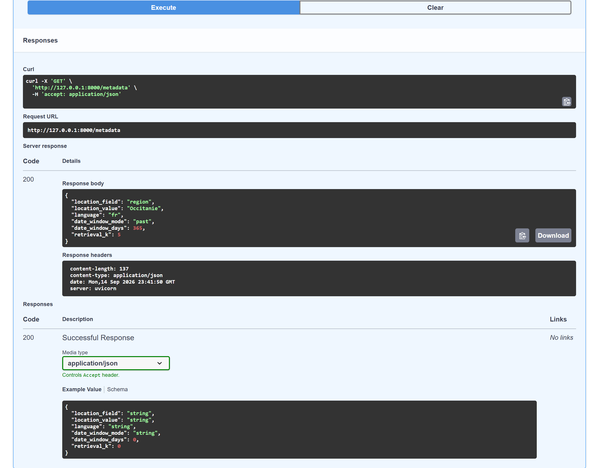
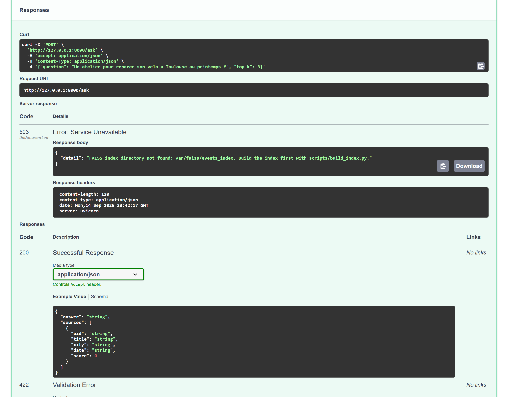

# Running and operating the service

## Starting it

```bash
cp .env.example .env                      # then set EVENTS_RAG_MISTRAL_API_KEY
uv sync
uv run python scripts/build_index.py      # ~1 min, embeds 2 046 chunks through the paid API
docker compose up                         # API on :8000, OpenAPI page at /docs
```

The index is written under `var/faiss/<index name>/`, and git does not track it. Rebuilding it
from the committed corpus avoids storing its 2 046 vectors in git.

`docker compose up` runs the API in a container built from the `Dockerfile`, with the variables
of `.env`. The image carries no index. `docker-compose.yml` mounts the local `var/` directory at
`/app/var`, so the container serves the index that `build_index.py` wrote on the host, and
`/rebuild` writes its new index to the same directory. On a Linux host, the user of the
container, uid 1000, needs write access to `var/` for `/rebuild` to succeed. Without Docker,
`uv run uvicorn events_rag.api.main:app` serves the same API from the working tree.

Without a key or an index, the service still starts, and `/health`, `/metadata` and the OpenAPI
page all answer. `/ask` returns 503 while the index is missing, with a message naming the script
that builds it, and 400 when the index exists but the key does not. The liveness route touches
neither the index nor the model on purpose. It reports whether the process runs, and the status
codes of `/ask` report on the index and the key.

## The four routes

The OpenAPI schema that the application generates from its Pydantic models is the reference,
served at `/docs` and `/openapi.json` while the service runs. This section adds what the schema
leaves out: what each route costs, and how it fails.

**`GET /health`** answers `{"status": "ok"}` as soon as the process is up, without touching the
index or the model. It can therefore serve as a container probe, and the `HEALTHCHECK` of the
image calls it.

**`GET /metadata`** returns the ingestion filter this deployment is configured with (the location
field and its value, the language, the date window mode and its length) and the `retrieval_k`
setting. It reads the settings object, so it reports the configuration the process runs with.
With the values of `.env.example`, that configuration is the one the committed corpus was built
with. Use it to tell two deployments apart before comparing their answers.

<!-- source: docs/images/MANIFEST.json -->


**`POST /ask`** is the route the service exists for. It takes a question and an optional depth:

```json
{ "question": "Un atelier vélo à Toulouse au printemps ?", "top_k": 3 }
```

`question` is 3 to 500 characters long and `top_k` is 1 to 10. Both bounds are in the schema, so
a malformed call is refused before it reaches the model. A request without `top_k` retrieves the
number of chunks set by `EVENTS_RAG_RETRIEVAL_K`, which is 5 when the variable is unset. The
answer carries the events it was built from, each with its `uid`, so the answer can be checked
against the records of the corpus. Each question costs one embedding call and one generation
call, both paid.

**`POST /rebuild`** re-embeds the committed corpus and replaces the index on disk. It requires the
token configured in `EVENTS_RAG_REBUILD_TOKEN`. When the server has no token configured, the route
answers 500 and runs nothing, and a wrong token gets a 403. It rebuilds from
`data/raw/events.json` without re-ingesting anything from the upstream portal. This is the
expensive route, and the only one behind a secret.

## Watching it

| Signal | Where | What it means |
|---|---|---|
| `GET /health` | the container's `HEALTHCHECK` | the process is up and serving |
| `GET /metadata` | manual | the ingestion filter and the retrieval setting this deployment is configured with |
| `events_rag` structured logs | stdout, JSON | two lines per question: the question, the depth and the number of chunks retrieved, then the question and the number of chunks given to the model |

Each `events_rag` log line is a JSON object, so a script can read the number of chunks a question
retrieved from a field. `EVENTS_RAG_LOG_LEVEL` sets the level. At the default, `INFO`, each
question produces the two lines above, and the first question after startup adds a line for the
loading of the index.

## Rebuilding the index

There are two ways, and both run the same function:

```bash
uv run python scripts/build_index.py
curl -X POST localhost:8000/rebuild -d '{"token":"..."}' -H 'Content-Type: application/json'
```

`EVENTS_RAG_REBUILD_TOKEN` guards the route. While the token on the server is empty, every call is
refused, so a service left unattended cannot be made to spend the key. Rebuilding embeds every
chunk of the corpus, so the guard controls cost as much as access.

A running service keeps the index it has loaded in memory, because `load_vectorstore` caches it.
A rebuild through `/rebuild` empties that cache, so the next question reads the new index. An
index rebuilt by `scripts/build_index.py` while the service runs is served once the process
restarts.

Rebuilding does not re-ingest. The service serves the corpus committed beside it, and replacing
that corpus is a separate step, documented as such (`scripts/build_dataset.py`).

## What a run costs

Building the index embeds 2 046 chunks, which the Mistral client sends in batches of up to 16 000
tokens, and takes about a minute. Answering one question makes one embedding call and one
generation call. The ablation builds three indexes, then embeds each question once for every
configuration that includes dense search, and takes about three minutes. `scripts/evaluate_rag.py`
asks the thirty evaluation questions through the service code, with one embedding call and one
generation call each. The RAGAS evaluation generates thirty answers and adds the calls of the
judge model, about ten minutes. `scripts/generate_eval_dataset.py` makes 22 chat calls when it
regenerates the question set. These are the only parts of the repository that call a paid API.

## When something is wrong

**The index is missing.** `/ask` answers 503. Run `scripts/build_index.py`, or check that
`EVENTS_RAG_INDEX_DIR` points to where the index was written. A fresh clone is in this state, and
so is a container started before the index was built on the host. The response names the script
that builds the index:

<!-- source: docs/images/MANIFEST.json -->


**A question fails validation.** `/ask` answers 422 when the question is shorter than 3
characters or longer than 500, or when `top_k` is outside 1 to 10. The bounds are in the OpenAPI
schema.

**Answers cite events from the wrong town.** The shipped retrieval has no town filter. It ranks
chunks by embedding similarity alone, so an event elsewhere can outrank one in the town the
question names. A larger `top_k` gives the model more candidates. The `dense+city-filter` row of
the ablation table measures what a town filter would add, and it should be read before drawing a
conclusion from a single question.

**Answers come back, but none of the sources fit.** The index may have been built from a
different corpus. `var/faiss/<name>/manifest.json` records the chunking parameters, the embedding
model and the number of source documents the index was built from. Compare it with
`reports/corpus_profile.json`.

## Credentials

The service needs two secrets: a Mistral API key, and a rebuild token that whoever runs the
service chooses.

| Variable | Issued by | Where to create it | Where it is read |
|---|---|---|---|
| `EVENTS_RAG_MISTRAL_API_KEY` | Mistral AI | [console.mistral.ai/api-keys](https://console.mistral.ai/api-keys), *Create new key* | `.env` in the working directory for the scripts and the local server; `docker-compose.yml` passes it to the container |
| `EVENTS_RAG_REBUILD_TOKEN` | whoever runs the service | any long random string: `python -c "import secrets; print(secrets.token_urlsafe(32))"` | `.env`; while it is empty, `/rebuild` refuses every call |

`.env.example` sets the token to the placeholder `change_me_local_token`, so a copied `.env`
should get a new value before the service is exposed.

The corpus, the question set, the results and the figure are all in the repository, and no other
service hosts any of them. From a fresh clone, the commands of [Starting it](#starting-it) bring
the service back, and the index build is the step that spends the key
([What a run costs](#what-a-run-costs)).

Once the key is no longer needed, delete it from the same page. A key that still works can still
be used by whoever obtains it, and creating a new one takes a minute.
